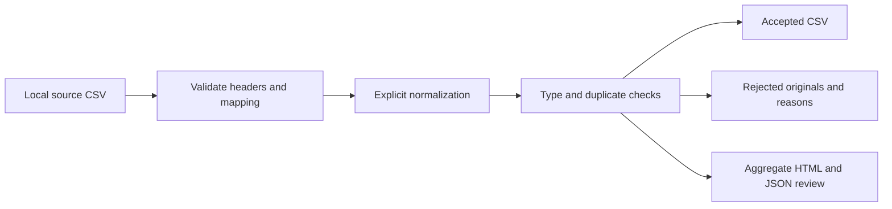

# RevOps Import Workbench

**Prepare CRM import files with explicit mappings, validation, and a review trail.**

A local command-line tool for Salesforce/RevOps implementation work. It maps CSV columns to CRM field names, applies configured normalization, validates records, and separates accepted rows from rows needing review. The source file remains unchanged. No data is sent to a CRM, LLM, or other service.

**Status:** working local utility with offline tests. It does not perform CRM imports or certify that a target CRM will accept every record.

## Business problem

CRM import preparation often involves fragile spreadsheet edits: renamed columns, lost leading zeros, inconsistent emails, duplicates, or rejected rows with no explanation. A configuration-driven workflow makes these decisions repeatable and reviewable.

## Quick start

Python 3.9+; no external dependencies or credentials.

```bash
python3 workbench.py inspect examples/leads.csv
python3 workbench.py transform examples/leads.csv \
  --mapping examples/lead-mapping.json --out output/example-run
python3 -m unittest discover -s tests -v
```

The included test fixture produces **4 input records, 2 accepted, 2 rejected**: one duplicate email and one invalid email. These are test outcomes, not client metrics. A run with rejected rows exits with code 1 even though reports are generated successfully. Exit 0 means no rejected records; exit 2 means an input, configuration, or processing error.

Open `output/example-run/review.html` for an aggregate review. Inspect `report.json` for record numbers and error codes.

## Use your real files

Create `private/`, place your authorized source CSV and mapping there, and run:

```bash
python3 workbench.py inspect private/source.csv
python3 workbench.py transform private/source.csv \
  --mapping private/mapping.json --out output/review-01
```

Input and mapping files need not be in the repository. Use a new output directory for every run. Existing outputs are never overwritten. The example data is only a test fixture; the tool accepts real local files.

## Outputs

| File | Purpose | Contains business records? |
| --- | --- | --- |
| `accepted.csv` | Mapped records that passed configured checks | Yes |
| `rejected.csv` | Original values as JSON plus source record number and reasons | Yes; may contain unsafe spreadsheet text |
| `report.json` | Counts, input/mapping hashes, ignored columns, record numbers, error codes | No row values; column names may be sensitive |
| `review.html` | Standalone aggregate review and next steps | No row values |

Record numbers count logical CSV records, including the header as record 1; quoted multiline cells do not create extra records. Malformed rows retain all their original values in `rejected.csv`.

## Mapping contract

```json
{
  "delimiter": ",",
  "unmapped_columns": "reject",
  "unique_key": ["Email"],
  "columns": [
    {"source": "Work Email", "target": "Email", "type": "email",
     "required": true, "normalize": ["trim", "lower"]},
    {"source": "Reference", "target": "External_ID__c", "type": "text"}
  ]
}
```

- Types: `text`, `email`, `number`, `date`, `boolean`, `phone`.
- Normalization is opt-in: `trim`, `lower`, `upper`, applied in the given order.
- Text values retain leading zeros. Use text for identifiers.
- Numbers use decimal arithmetic, accept decimal points, and reject non-finite/extreme values. Locale-specific thousands separators and decimal commas are not inferred.
- Dates require `YYYY-MM-DD`. Booleans accept true/false, yes/no, 1/0.
- Email checks validate basic shape only; they do not verify deliverability.
- Delimiters: comma, semicolon, tab, pipe. Encoding: UTF-8, with optional BOM.
- Duplicate policy: the first valid normalized key wins; later duplicates go to review. Missing key components are rejected. This is exact matching, not fuzzy identity resolution.
- Unmapped source columns stop the run unless you explicitly select `"unmapped_columns": "ignore"`. Ignored columns are listed in the report.
- Invalid mappings and duplicate headers stop the run. Row validation errors quarantine individual records.

## Architecture and reliability



The same input and mapping produce the same accepted output and reports. Hashes identify which versions were processed. The tool reads the CSV into memory, so very large datasets require a different streaming implementation. For high-volume migrations, use a migration system with target-schema inspection and transaction support.

There is no outbound connector, database, background process, or LLM call. No environment variables are required. This project provides deterministic integration preparation; it is not an AI agent.

## Optional coding-agent workflow

Claude Code can assist with a mapping using `CLAUDE.md`: provide the source headers and your approved target field names; have it draft the mapping; review the rules yourself; then run the local validator. You do not need to send row values to an AI service. A coding agent is optional and separately authenticated.

## Tests

Ten tests verify normalized deduplication, leading-zero preservation, invalid-first-record behavior, malformed-row retention, formula quarantine, valid negative numbers and international phones, bad dates and numbers, no-overwrite behavior, BOM/delimiters/multiline fields, and reproducibility without leaking row values into reports.

## Security and operational limitations

Keep `private/` and `output/` outside publication; both are ignored by Git. Output directories are created with private permissions, but no file encryption is provided. Open rejected files in a text editor: they deliberately preserve original values, including formula-like content. The validator quarantines potentially executable spreadsheet text rather than silently changing it. This is a defense in depth measure, not a guarantee that arbitrary data is safe in every spreadsheet application.

Validate target CRM field names, permissions, required fields, consent semantics, and duplicate strategy separately. `Consent__c` in the example is a custom field, not a claim about a built-in Salesforce consent model. Test accepted files in an authorized sandbox before a real import. Nothing is automatically uploaded.

## Contribution and AI assistance

Created with Codex from Itziar Fernández Fernández's request for a practical RevOps portfolio tool. Itziar supplied the business direction; Codex generated the initial code, tests, and documentation. Record Itziar's review, use with authorized files, and later improvements when completed. No employer or client repositories were copied. No production usage or business savings are claimed.
